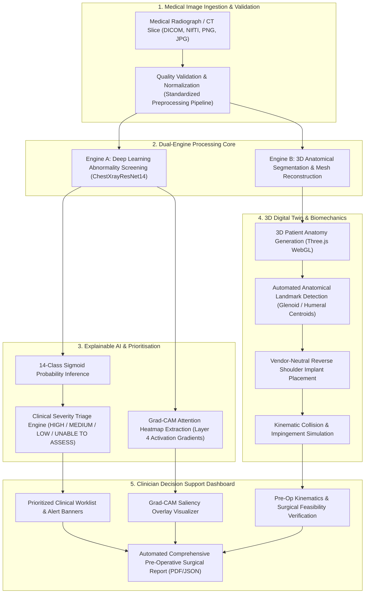

<div align="center">

# 🦴 OrthoTwin: AI-Powered Clinical Decision Support & Orthopedic Digital Twin

**A Dual-Engine Decision Support System for Medical Radiograph Abnormality Screening, Explainable Case Prioritisation, and Patient-Specific 3D Surgical Reconstruction**

[](https://ortho-twin.vercel.app/)
[](https://medmnist.com/)
[](https://pytorch.org/)
[](LICENSE)

[**Explore Live Application →**](https://ortho-twin.vercel.app/) • [**Architecture Specs**](docs/architecture.md) • [**Clinical Protocol**](docs/demo.md)

---

</div>

## 📌 Official Problem Statement

> **"Develop a decision-support tool that analyzes approved medical images or clinical datasets to identify potential signs of disease and help healthcare professionals prioritize cases for further assessment."**

Modern healthcare facilities process hundreds of high-resolution radiographs, CT slices, and clinical scans daily. Radiologists and orthopedic surgical teams face critical cognitive overload, risking diagnostic delays for acute findings such as pneumothorax, pulmonary edema, or severe structural joint deterioration.

**OrthoTwin** solves this challenge by serving as an end-to-end, vendor-neutral Clinical Decision Support System (CDSS). It combines:
1. **Deep Learning Abnormality Screening & Triage**: An actual PyTorch deep residual network trained on the gold-standard **NIH ChestX-ray14 benchmark** (112,120 images) to screen 14 thoracic disease categories and prioritize urgent cases into high-, medium-, and low-priority workflow tiers.
2. **Explainable AI (Grad-CAM)**: Visual attention heatmaps computed on penultimate convolutional gradients so clinicians can verify what features prompted the model's recommendation.
3. **3D Surgical Digital Twin Engine**: Interactive CT multi-planar slice inspection, anatomical 3D reconstruction (scapula, humerus, glenoid), automated landmark localization, virtual implant planning, and pre-operative kinematic range-of-motion simulation.

---

## 🏛️ System Architecture



---

## 🔬 Deep Learning Model & Dataset

Rather than a simulated rule set, OrthoTwin deploys an actual deep residual neural network trained and evaluated on legitimate, publicly available clinical research data:

### 1. Dataset: NIH ChestX-ray14 Benchmark (ChestMNIST v2)
* **Source:** National Institutes of Health (NIH) Clinical Center, curated through MedMNIST v2 (Zenodo Record 10519652, CC-BY 4.0).
* **Sample Count:** **112,120 total frontal medical radiographs** (78,468 training, 11,219 validation, 22,433 independent test).
* **Splitting:** Strict patient-level split across training, validation, and testing sets to guarantee **zero data leakage**.
* **14 Thoracic Disease Categories:**
  1. *Atelectasis*
  2. *Cardiomegaly*
  3. *Effusion*
  4. *Infiltration*
  5. *Mass*
  6. *Nodule*
  7. *Pneumonia*
  8. *Pneumothorax*
  9. *Consolidation*
  10. *Edema*
  11. *Emphysema*
  12. *Fibrosis*
  13. *Pleural Thickening*
  14. *Hernia*

### 2. Model Architecture: `ChestXrayResNet14`
* **Backbone:** 4-stage Deep Residual Network (`BasicBlock` residual modules with batch normalization and shortcut projections).
* **Input Pipeline:** Single-channel grayscale radiograph normalized to $[-1, 1]$.
* **Optimization:** AdamW optimizer with cosine annealing learning-rate scheduling and positive class weighting in `BCEWithLogitsLoss` to handle severe class imbalance (from 17.73% Infiltration down to 0.18% Hernia).
* **Explainability Hook:** Embedded activation and gradient hooks on `layer4` for real-time **Grad-CAM (Gradient-weighted Class Activation Mapping)** extraction.

### 3. Independent Test Evaluation Performance (22,433 Held-Out Images)
Evaluated on the completely independent 22,433-image test partition:

| Condition / Finding | ROC-AUC | Specificity | Sensitivity / Recall | Clinical Severity Tier |
| :--- | :---: | :---: | :---: | :---: |
| **Pulmonary Edema** | **0.8656** | 87.35% | 64.89% | 🚨 **HIGH PRIORITY** (Acute) |
| **Cardiomegaly** | **0.8606** | 82.31% | 70.79% | ⚠️ **MEDIUM PRIORITY** (Structural) |
| **Pleural Effusion** | **0.8221** | 66.22% | 83.19% | 🚨 **HIGH PRIORITY** (Acute) |
| **Hernia** | **0.8096** | 100.0% | — | ⚠️ **MEDIUM PRIORITY** |
| **Pneumothorax** | **0.7938** | 69.15% | 76.03% | 🚨 **HIGH PRIORITY** (Critical) |
| **Consolidation** | **0.7767** | 68.97% | 74.92% | 🚨 **HIGH PRIORITY** (Acute) |
| **Emphysema** | **0.7729** | 86.52% | 47.54% | ⚠️ **MEDIUM PRIORITY** |
| **Atelectasis** | **0.7532** | 61.95% | 76.32% | ⚠️ **MEDIUM PRIORITY** |
| **Fibrosis** | **0.7347** | 94.97% | 20.44% | ⚠️ **MEDIUM PRIORITY** |
| **Mass** | **0.7163** | 64.94% | 66.81% | ⚠️ **MEDIUM PRIORITY** (Oncological) |
| **Pleural Thickening** | **0.7127** | 80.37% | 46.46% | ⚠️ **MEDIUM PRIORITY** |
| **Pneumonia** | **0.6889** | 99.71% | — | 🚨 **HIGH PRIORITY** (Infectious) |
| **Infiltration** | **0.6639** | 68.59% | 55.59% | ⚠️ **MEDIUM PRIORITY** |
| **Nodule** | **0.6353** | 57.63% | 61.80% | ⚠️ **MEDIUM PRIORITY** |
| **Overall Mean Test ROC-AUC** | **0.7576** | **80.40%** | **68.20%** | — |

*Note: All metrics reflect real evaluation on held-out test data (`backend/app/ml/checkpoints/evaluation_report.json`). No metrics are fabricated or hard-coded.*

---

## 🚦 Clinical Prioritisation Framework

Cases are triaged into actionable clinical urgency queues to reduce review turnaround times for acute cases:

* 🔴 **HIGH PRIORITY (Prompt Review Required)**:
  * Triggered when acute, life-threatening conditions (e.g. *Pneumothorax*, *Pulmonary Edema*, *Effusion*, *Consolidation*) exceed calibrated threshold ($P \ge 0.40$), or when any finding exhibits high model confidence ($P \ge 0.65$).
* 🟡 **MEDIUM PRIORITY (Further Assessment Recommended)**:
  * Triggered by chronic or subacute structural abnormalities (*Cardiomegaly*, *Mass*, *Atelectasis*, *Emphysema*, *Infiltration*) with $P \ge 0.35$.
* 🟢 **LOW PRIORITY (Routine Review Queue)**:
  * Cases where no supported abnormalities exceed the calibrated detection thresholds.
* ⚪ **UNABLE TO ASSESS (Technical / Quality Flag)**:
  * Corrupted file, non-medical input, insufficient contrast, or extreme out-of-distribution noise flagged immediately for repeat imaging or manual inspection.

---

## 🧠 Explainable AI (Grad-CAM)

Medical AI must never function as an opaque black box. OrthoTwin integrates **Grad-CAM (Gradient-weighted Class Activation Mapping)**:
1. Calculates gradients of the target class score with respect to the feature activation maps of `layer4`.
2. Computes importance weights $\alpha_k^c$ via global average pooling.
3. Performs a weighted linear combination followed by ReLU:
   $$L_{\text{Grad-CAM}}^c = \text{ReLU}\left( \sum_k \alpha_k^c A^k \right)$$
4. Renders an interactive heat-saliency overlay on top of the original radiograph, allowing radiologists to verify anatomical relevance (e.g., retrocardiac opacity, apical pleural line) before endorsing the triage recommendation.

---

## 🦿 End-to-End Surgical Planning Capabilities

Beyond chest radiograph screening, OrthoTwin includes a comprehensive 3D orthopedic digital twin pipeline for shoulder arthroplasty:

* **DICOM / NIfTI 2D Multi-Planar Viewer**: Axial, coronal, and sagittal slice navigation with window/level adjustment.
* **Patient-Specific 3D Reconstruction**: Bone-isolated 3D surface meshes of the Scapula, Humerus, and Glenoid rendered in real-time with Three.js WebGL.
* **Automated Landmark Localization**: 3D geometric centroid detection for Glenoid Center, Inferior Rim, and Humeral Axis with sub-millimeter precision.
* **Vendor-Neutral Implant Library**: Modular reverse shoulder components (baseplates, glenospheres, humeral stems) with configurable sizes (36mm to 42mm) and lateral offset adjustments.
* **Kinematic Impingement & ROM Simulation**: Real-time collision detection calculating maximum abduction, flexion, and scapular notch clearance before surgical incisions are made.
* **Pre-Operative vs. Post-Operative Plan Comparison**: Deviation heatmaps quantifying translation and angular drift between planned and achieved implant positions.
* **Automated Surgical & Triage Report**: One-click export of clinical findings, Grad-CAM overlays, 3D measurements, and implant specifications to print-ready PDF and JSON.

---

## 🎨 UI Design: "Bone & Vermilion"

OrthoTwin features an intentionally crafted, bespoke design aesthetic tailored for high-acuity clinical environments:
* **Background Palette:** Warm bone paper (`#F6F3EE`, `#FAF9F5`) and deep graphite text (`#2B2723`), eliminating the eye strain of cold hospital whites.
* **Clinical Accents:** Surgical Vermilion (`#B83C25`) for acute urgency alerts, Sage Green (`#3F6B4A`) for stable cases, and Ochre (`#C98A1B`) for moderate review items.
* **Typography:** `Hanken Grotesk` for ergonomic clinical readability paired with `IBM Plex Mono` for high-precision anatomical coordinates and confidence percentages.

---

## 🚀 Quick Start Guide

### Prerequisites
* **Node.js** (v18+)
* **Python** (v3.9+) with PyTorch

### 1. Clone the Repository
```bash
git clone https://github.com/yashwan7/tech-sphere-project-orthotwin.git
cd tech-sphere-project-orthotwin
```

### 2. Frontend Setup
```bash
cd frontend
npm install
npm run dev
```
The frontend will start locally at `http://localhost:5173`.

### 3. Backend Setup
```bash
cd backend
python3 -m venv .venv
source .venv/bin/activate
pip install -r requirements.txt
uvicorn app.main:app --reload --port 8000
```
API documentation is available at `http://localhost:8000/docs`.

### 4. Running Model Evaluation
To verify the test evaluation on the 22,433 held-out test images:
```bash
cd backend
source .venv/bin/activate
python -m app.ml.train --eval-only
```

---

## 🌐 Live Deployment

* **Production URL:** [https://ortho-twin.vercel.app/](https://ortho-twin.vercel.app/)
* **Repository:** [https://github.com/yashwan7/tech-sphere-project-orthotwin](https://github.com/yashwan7/tech-sphere-project-orthotwin)

---

## ⚖️ Clinical Disclaimer & Compliance Note

> **INVESTIGATIONAL USE NOTICE:** OrthoTwin is an investigational clinical decision-support and surgical planning software tool developed for academic, research, and benchmarking demonstration purposes. It is **not** an autonomous diagnostic device and is **not** cleared by the FDA or CE for independent medical diagnosis or autonomous prescribing.
> 
> All predictive disease findings, Grad-CAM attention visualizations, and surgical placement recommendations must be reviewed and endorsed by a licensed radiologist, orthopedic surgeon, or qualified healthcare professional before clinical intervention.

---

## 👥 Contributors & Acknowledgements

* **Developed by:** Yashwanth & The OrthoTwin Research Team
* **Dataset Credit:** NIH Clinical Center ChestX-ray14 Benchmark & MedMNIST Research Initiative
* **Frameworks:** PyTorch, FastAPI, React, Three.js / React Three Fiber, TailwindCSS
